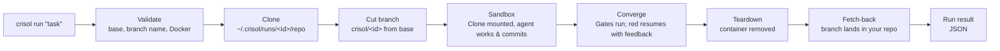

<p align="center">
  <picture>
    <source media="(prefers-color-scheme: dark)" srcset="assets/crisol-dark.svg">
    
  </picture>
</p>

<h1 align="center">Crisol</h1>

<p align="center">
  <strong>Run one Task in a container, unattended, and get back exactly one branch.</strong>
</p>

<p align="center">
  
  
  
  
</p>

---

A *crisol* (crucible) holds the fire while it works. Crisol does the same for a coding agent. It
clones your repo, runs the agent inside a Docker **Sandbox** that cannot touch your host, and
leaves **one named branch** in your repo when it is done. That happens whether the Run succeeded
or failed. Your working tree is never touched.

```console
$ crisol run "fix the login bug with + in emails" --json
{"run":"9f496a56","branch":"crisol/9f496a56","base":"main@a2689ba","status":"unverified", …}
```

## Why

You can tell an agent to work on its own, but that is only safe if nothing it does can leak out.
Crisol keeps a Run apart from your host in three ways:

- **Its own Clone.** A Run never works in your checkout or a worktree. It gets a fresh clone that
  shares no `.git` and no objects with your repo
  ([ADR 0004](docs/adr/0004-clone-copies-objects-no-hardlinks.md)).
- **Its own Sandbox.** The agent runs in a container, and the only part of your machine it can see
  is that Clone.
- **One way back.** The only thing that returns to your repo is a branch, brought back by
  **Fetch-back**. Fetch-back runs `git fetch`; it never merges and never touches a working tree.

## How a Run works



1. **Validate first.** Crisol checks the base ref, the branch name and Docker before it touches
   anything, so an invalid Run leaves nothing behind.
2. **Clone and cut.** Crisol clones your repo with `git clone --no-local`. That copies only the
   objects reachable from your branches, tags and `HEAD`, so a dropped stash never gets into the
   Clone. Then it cuts `crisol/<id>` (or your `--name`) from the base.
3. **Sandbox.** The Clone is bind-mounted into a container at the same absolute path. The Adapter
   does the work and commits there.
4. **Converge.** Crisol — never the agent — decides done. It runs every declared Gate; any red one
   resumes the same session with the failing command and its output, up to a ceiling (5 iterations
   or 60 minutes). The Gates judge only what Fetch-back will bring back: while the Clone has
   uncommitted changes or `HEAD` is off the Run's branch, no Gate runs and the agent is told to
   commit, which spends an iteration like a red Gate. What the dependency install itself left dirty,
   such as a rewritten lockfile or an untracked `node_modules`, does not count while it stays as the
   install left it. All green is `verified`; no Gate declared
   anywhere is `unverified`; hitting the ceiling is `not-converged`.
5. **Teardown and Fetch-back.** The container is removed, and the branch is fetched back into
   your repo. If the Run fails, Fetch-back still runs, so no work is lost. If it fails too, you
   see both errors. Ctrl+C, `kill` and closing the terminal stop a Run the same way, in any
   step from the Services' start to the last Gate: the container is removed and the branch still
   comes back with the commits made so far. Only
   `kill -9` skips this, and `crisol recover` brings that branch back.

## Requirements

| | |
|---|---|
| **OS** | macOS, Apple silicon or Intel (Linux is planned) |
| **Containers** | A running Docker engine: OrbStack, Docker Desktop, or Colima |
| **Agent** | Claude Code (`claude`) on your host; the Sandbox installs the same version |
| **Repo** | Any git repo with at least one commit |

## Install

```sh
brew tap matiinchauspe/crisol https://github.com/matiinchauspe/crisol
brew install matiinchauspe/crisol/crisol
crisol --version
```

Use the full name in `brew install`. Homebrew only loads formulae from taps you trust, and the
full name is how you tell it you trust this one. A plain `brew install crisol` fails with
"Refusing to load formula … from untrusted tap". If you see that error, run
`brew trust --formula matiinchauspe/crisol/crisol`.

## Getting started

1. **Authenticate once.** `crisol auth` runs `claude setup-token` and stores the token in
   Crisol's own macOS Keychain entry, never on disk:

   ```sh
   crisol auth
   ```

2. **Onboard a repo.** From inside the repo, `crisol init` writes `.crisol/config.toml` with Gates
   taken from your `package.json` scripts, an empty `.crisol/network`, and a `## Sandbox` block in
   `AGENTS.md` (or `CLAUDE.md`). It never overwrites a file that is already there. It then offers a
   first `--network learn` Run that records the hosts your repo needs; answer `y` or skip it.
   Review and commit `.crisol/`:

   ```sh
   crisol init
   ```

3. **Run a Task.** Crisol clones the repo, lets Claude Code work in a Sandbox until every Gate is
   green, and fetches back one branch:

   ```sh
   crisol run "fix the login bug with + in emails"
   ```

   Read the result's `status`: `verified` means every Gate passed. Review the branch it names
   like any other.

## Usage

```
crisol run ("<task>"... | --file <md>) [--context <md>]... [--prompt <name>] [--json | --detach] [--base <ref>] [--name <branch> | --continue <branch>] [--gate <cmd>]... [--max-iterations <n>] [--timeout <minutes>] [--network <allowlist|learn|open>] [--adapter <fake|claude-code>]
crisol allow <host> [--repo]
crisol status
crisol logs <run>
crisol auth
crisol recover
crisol gc [--include-failed]
crisol init [--adapter <fake|claude-code>]
crisol --version
```

| Flag | Default | What it does |
|---|---|---|
| `--file <md>` | none | The file's content is the Task, in place of a phrase. One file, and not beside a phrase. |
| `--context <md>` | none | A reference file the agent gets after the Task, in its own section, marked as reference rather than work. Repeatable. |
| `--prompt <name>` | none | Wraps the Task in a template. See [The Task the agent gets](#the-task-the-agent-gets). |
| `--base <ref>` | your current `HEAD` | Branch, tag or sha to cut the Run's branch from. It must be reachable from a local branch, a tag or `HEAD`, because that is all the Clone receives. To use `origin/main`, check it out or fast-forward a local branch onto it first. |
| `--name <branch>` | `crisol/<id>` | The branch name the Run leaves in your repo. Refused before anything happens if it clashes with an existing branch, a tag, or a branch path (for example `feat` vs `feat/x`). Only with a single Task. |
| `--continue <branch>` | none | Takes up again the finished Run whose own Clone still holds this branch, with the Task as the new request. Not with `--name`, `--base`, `--detach` or several Tasks. See [Continue a Run](#continue-a-run). |
| `--gate <cmd>` | none | A command whose exit code decides whether the work is right. Repeatable. Any `--gate` replaces your repo's own `.crisol/config.toml` Gates entirely — it never merges with them. |
| `--max-iterations <n>` | `5` | Overrides how many Gate-fail-then-resume attempts this Run gets before `not-converged`. Must be a positive integer. |
| `--timeout <minutes>` | `60` | Overrides the wall-clock ceiling for this Run, in minutes. Must be a positive integer. |
| `--network <allowlist\|learn\|open>` | `allowlist` | `learn` lets the Run reach any host and records which; `open` drops the wall. See [Network](#network). |
| `--adapter <fake\|claude-code>` | `claude-code`; on `--continue`, the Run's own recorded Adapter | Which Adapter runs the Task. `claude-code` runs Claude Code (`crisol auth` first — see [Credentials](#credentials)); `fake` is the suite's own scripted stand-in, which does no work. See [Continue a Run](#continue-a-run) for how a Continuation matches it. |
| `--json` | off | Print the Run result as JSON instead of one line — one JSON line per Run when there are several Tasks. |
| `--detach` | off | Return at once with the run id and let the Run finish in the background. One Task only, and not with `--json`. See [Detach, status and logs](#detach-status-and-logs). |

A repo can declare its own Gates once, in `.crisol/config.toml`:

```toml
gates = ["bun test", "bun run typecheck"]
```

### Onboard a repo

```
crisol init [--adapter <fake|claude-code>]
```

Prepares the repo you run it in, and never overwrites a file that is already there:

1. `.crisol/config.toml` with a Gate for each `typecheck`, `lint` and `test` script in
   `package.json`, run with the package manager its lockfile names (`bun run test`; `npm` with no
   lockfile). npm's placeholder `test` script, which always fails, is skipped.
2. `.crisol/network`, empty: the repo level of the Allowlist. No Services.
3. A `## Sandbox` block appended to `AGENTS.md`, else `CLAUDE.md`, else a new `AGENTS.md`. It
   declares two entry points for an agent that dispatches work: run one Task, and continue a Run by
   its branch, both with `--adapter claude-code --json`, and tells it to read `status`, not the exit
   code. A file that already has a `## Sandbox` heading is left alone, so a second `init` never
   adds another.

Then it offers a first learn Run (`[y/N]`; anything else declines). Accepting starts one
`--network learn` Run of a fixed Task, with one iteration, through `--adapter` (Claude Code by
default), and appends every host it reached that is neither built in nor on the repo level to
`.crisol/network`. Unlike `crisol run --network learn`, which only prints the lines, this writes
them: you asked for it, and the file is yours to review before you commit `.crisol/`
([ADR 0021](docs/adr/0021-crisol-init-writes-only-what-is-missing-and-declares-the-real-adapter.md)).

### The Task the agent gets

Crisol never reads a tracker: the Task is the text you give it. The agent receives, in order:

1. **The Preamble**: it is in a sandbox, the Gates this Run will check (by command), commit and do
   not push, say so in its Final message when the network blocks something rather than work around
   it, and end with a Stop line when it stops on purpose (see [The Run result](#the-run-result)). A
   `--detach`ed Run names the Gates its own background process re-resolves from
   `.crisol/config.toml`, not necessarily the ones the launching terminal saw — they can drift if
   that file changes in between (see ADR 0014's "Not addressed").
2. **The Task**, inside `<task>` tags, after `--prompt`'s template is applied.
3. **Each `--context` file**, inside its own `<reference file="…">` tags.

A template is a Markdown file whose only variable is `{{task}}`. Crisol looks for `--prompt <name>`
in three places, and the first found wins:

1. `.crisol/prompts/<name>.md` in your repo;
2. `~/.crisol/prompts/<name>.md`;
3. Crisol's built-in templates (`fix-bug`).

A template that uses any other `{{…}}`, or lacks `{{task}}`, fails the Run before anything happens.
A name starts with a letter or digit, followed by letters, digits, `-` and `_`.

`--file`, `--context` and templates must be UTF-8 text: a file with a NUL byte or invalid UTF-8 is
refused before anything happens, as is an empty one. Every file is read once, by the `crisol run`
you launched, even with `--detach`, so a temporary file can go as soon as the command returns.
The prompt the agent received is kept in `runs/<id>/prompt`.

```bash
crisol run --file tickets/42.md --context docs/spec.md --prompt fix-bug
```

### Several Tasks at once

```
crisol run "fix the login bug" "add a health check" "bump the README badges"
```

Each Task becomes its own independent Run: its own Clone, its own Sandbox, its own branch, all
cut from the same base commit. Crisol never chains or merges them — what to do with the branches
is up to you. With `--json`, each Run result is printed on its own line, in the order the Tasks
were given; a Run that fails prints its error on stderr, prefixed with its Task, and the command
exits non-zero without hiding the others.

At most `max_parallel` Runs execute at once (3 by default), across every `crisol run` on the
machine — including ones started from different terminals. A Run must hold one of
`~/.crisol/slots/<n>.lock` to execute; with none free it waits, printing
`Waiting for a free Slot`, and never fails for lack of one. The lock is an OS file lock, so a
Run that dies — even by `kill -9` — gives its Slot back at once. A waiting Run already has its run
id, so `crisol status` shows it as `queued`. Ctrl+C on a waiting Run stops it before it makes its
Clone, so it cuts no branch. Its log and Run result are kept, like any Run's: `not-converged`,
`reason: "interrupted: SIGINT"`.

```toml
# ~/.crisol/config
max_parallel = 2
```

### Provider failures and capacity

A rate limit, an exhausted quota or a failed authentication from the agent's own provider is not a
red Gate: the Run stops at once, without spending an iteration on it, `not-converged` with
`reason: "provider: <category>"` (for example `provider: rate limit`). With several Tasks at once,
it also keeps a Run still waiting for a Slot from starting, rather than let it begin only to hit
the same outage — that Run ends the same way a Ctrl+C-while-queued one does, with
`reason: "interrupted: provider: <category>"`.

The Claude Code Adapter classifies all three: a failed authentication as `provider: auth`, an
exhausted quota as `provider: quota`, and a rate limit as `provider: rate limit`. Anything else
`claude` exits non-zero on still ends the Run as `error: <message>`.

Each Sandbox is capped at 2 CPUs and 4 GB by default, overridable in `~/.crisol/config`:

```toml
# ~/.crisol/config
cpus = 4
memory = 8g
```

`memory` takes Docker's own size syntax (a byte count, or one with a `b`/`k`/`m`/`g` suffix). The
cap applies to the Sandbox only — never the Allowlist proxy or a Service container. An unreachable
Docker engine fails with a plain message naming how to start it (see
[Requirements](#requirements)), never a raw socket error.

### Detach, status and logs

```console
$ crisol run "fix the login bug" --detach
9f496a56
Run 9f496a56 detached as pid 41872. `crisol status` shows it; `crisol logs 9f496a56` prints its log; `kill 41872` stops it.
$ crisol status
9f496a56  running        crisol/9f496a56  pid 41872
3c1d07e2  queued         crisol/3c1d07e2  pid 41901
51b8aa90  verified       crisol/51b8aa90
$ crisol logs 9f496a56
```

`--detach` checks everything a Run checks before it starts. A bad base, name or Gate still fails
right there, and leaves nothing behind. Then it reserves the Run and hands it to a background
process of its own. Once that process holds the Run, `--detach` prints the id and the process's pid
and returns. From then on, the Run continues in that background process. Crisol has no daemon: that process owns the Run,
just as `crisol run` does in the foreground. Closing the terminal does not stop it. To stop it,
`kill` the pid that `--detach` and `crisol status` show. It then stops like a Run you Ctrl+C: a
running Run's container is removed and its branch comes back, and a queued Run ends without one. The Run result goes to `result.json`. Anything the Run would have printed,
including warnings, goes to its log.

`crisol status` lists every Run under `~/.crisol`, oldest first:

| State | Meaning |
|---|---|
| `queued` | Reserved, waiting for a free Slot. Shown with the pid of the process that owns it. |
| `running` | Holds a Slot and has its Clone. Shown with its pid. |
| `verified` / `unverified` / `not-converged` / `parked` / `checkpoint` | Finished; the Run result's Status, followed by its `reason` when there is one. |
| `dead` | Died without writing a Run result for its current round, for example after `kill -9` — a Continuation killed mid-round shows `dead` too, never the round before it. If it had made its Clone, `crisol recover` brings back its branch. A Run that died while queued never made one, so there is nothing to bring back. |

`crisol logs <run>` prints that Run's log. An id that is not a Run fails with a plain message.

### Continue a Run

```console
$ crisol run --continue crisol/9f496a56 --file review.md --json
```

A **Continuation** sends a new request to the agent of a finished Run, with its context, on the same
branch. Crisol finds the Run whose own Clone still holds the branch, re-takes its Run lock and a
Slot, starts a new Sandbox over that same Clone, and resumes the agent's own session with the
request. The Gates run as in any Run — `--gate` when given, else the ones the Run had — and a Stop
line ends it the same way. Fetch-back then moves the existing branch forward.

`result.json` is rewritten with this round's `status`, `finalMessage` and a new `finishedAt`; the
`log` keeps every round. A branch no Run's Clone holds — nobody ever named it, its Run ended before
a Slot, or `crisol gc` already collected it — is refused before anything starts; so is one two Runs'
Clones both hold, naming both. So is a branch checked out in your repo or one of its worktrees, or
one whose tip in your repo no longer matches the Run's Clone — either would leave the Clone diverged
from your repo for good once a round ran on top of it, so both are checked, and reported by name,
before any Sandbox starts rather than only at Fetch-back. The agent's session survives its Sandbox
because Crisol keeps it under the Run dir, in `sessions/`.

Every Run result also names the Adapter that made it. `--continue` with no `--adapter` inherits
that one, printing `Continuing Run <id> with Adapter <name> (recorded by the Run).`; naming a
different `--adapter` is refused, naming both, before any Sandbox starts — and so is a Run from
before Crisol recorded one, which asks for `--adapter` rather than assuming the fake Adapter. An
Adapter that implements `continueSession` must carry a `name`, or a Run refuses it.

While a round runs, `crisol status` shows it `queued` or `running`, never the previous round's
outcome. A Continuation stopped while still queued for a Slot changed nothing, so the previous
round's result stays current. One killed mid-round shows `dead`; after `crisol recover`, its result reads
`not-converged`, `interrupted: …`, with no `finalMessage` — the round before it never wrote one, so
that message is dropped rather than shown as this round's own.

### Network

Every Sandbox sits on its own Docker `--internal` network — no route out at all except through a
proxy that allows HTTPS `CONNECT` on port 443 (and plain HTTP on port 80) to an Allowlist, with no
TLS interception and no certificate anywhere in the image. The built-in Allowlist covers the Anthropic API and the package
registries a Run needs to install dependencies (`registry.npmjs.org`, `registry.yarnpkg.com`,
`repo.yarnpkg.com`, `github.com`, `codeload.github.com`, `objects.githubusercontent.com`,
`release-assets.githubusercontent.com`, `pypi.org`, `files.pythonhosted.org`).
A host it doesn't name is refused, and every refusal is counted:

```json
"blocked": [{ "host": "api.stripe.com", "count": 3 }]
```

The end-of-run report names each one and the line that would allow it:

```
Blocked: api.stripe.com (3 attempts). Allow it for every repo, or for this repo only, with:
  crisol allow api.stripe.com
  crisol allow api.stripe.com --repo
```

Only a plain hostname gets those lines. An IP literal, or a host carrying anything but letters,
digits, dots and hyphens, is printed quoted with nothing to paste. A host already on the
Allowlist that was refused for its form (a bare `CONNECT github.com`, say) gets no line either.

An allowlisted host reached on any other port is refused too, and its entry carries the port
(`{ "host": "github.com", "port": 22, "count": 1 }`) — no `crisol allow` line opens a port.

#### Widening the Allowlist

The Allowlist a Run gets is three levels merged:

| Level | Where | Edited by |
|---|---|---|
| built-in | inside Crisol | each release |
| user | `~/.crisol/network` | `crisol allow <host>` |
| repo | `.crisol/network`, committed | `crisol allow <host> --repo` |

Both files hold one host per line; everything after a `#` is a comment:

```
# payments
api.stripe.com   # checkout
sentry.io
```

`crisol allow` appends one line, creating the file if needed, and never rewrites what is already
there. A host added at either level is reachable from the next Run on. Every level takes plain
public hostnames only — no port, no wildcard, no IP address, and no name that points inside your
machine or network (`host.docker.internal`, `metadata.google.internal`, anything under `.internal`,
`.local`, `.localhost`, `.localdomain`, `.svc`, `.arpa`, `.lan`, `.home` or `.corp`). An allowlist
Run whose user or repo level holds anything else fails before it starts, naming the file and the
host. `--network learn` and `--network open` read neither level, so a bad line never breaks them.

A repo's `.crisol/network` widens your wall: cloning a repo that carries one lets its Runs reach
those hosts. The agent can write it too, by committing to it, and once you merge that branch every
later Run reaches what it added. Crisol shows both and blocks neither. The Run log lists every host
the user or repo level brought (`allowlist: 8 built-in; user: …; repo: …`). A branch whose changes
touch `.crisol/network` carries a `warnings` entry naming the hosts it adds. Read that file in a
review the way you would read a dependency bump.

`--network learn` lets a Run reach any host through the proxy, and records every host the proxy
connected to in the Run result's `reached`. The Sandbox stays on its `--internal` network, so only
HTTP and HTTPS through the proxy get out. Git over ssh, `git://`, a remote database, or any tool that
ignores the proxy variables still fails, and is never in `reached`. At the end, the plain-text report prints a
`crisol allow <host> --repo` line for each reached host that is neither built in nor on the repo
level — copy the ones the repo needs. It asks nothing and writes nothing. Hosts on your own user
level are proposed too, so teammates get them through the repo level. With `--json`, only the Run
result is printed; `reached` is in it.

`--network open` stands up no wall at all: the Sandbox sits on Docker's default network and
`network` reads `"open"`.

> [!WARNING]
> `--network learn` (through its proxy) and `--network open` filter nothing, on any port. The agent can reach the Docker
> host (`host.docker.internal`) and what listens on it, your LAN, other containers on the default
> bridge, and cloud metadata endpoints (`169.254.169.254`). Use them on code and data you would
> let leave your machine.

Package installs with Bun reach only `registry.npmjs.org`, already built in. Upgrading Bun itself
reaches `api.github.com` (`bun upgrade`) or `bun.sh` (the install script), and a raw file download
reaches `raw.githubusercontent.com`; those stay off the built-in list — a Run that needs one adds
it with `crisol allow` or finds it with `--network learn`
([ADR 0013](docs/adr/0013-allowlist-levels-learn-and-open.md)).

### Credentials

The Claude Code Adapter, the default, declares exactly one secret,
`CLAUDE_CODE_OAUTH_TOKEN`, resolved from `crisol auth`'s Keychain entry below — run that first, or
the Run fails before anything happens, naming it. A repo that needs another secret declares it by
NAME, never by value, in the same `.crisol/config.toml`:

```toml
env = ["NPM_TOKEN"]
```

`NPM_TOKEN` is then read from your own shell's environment at launch — export it before running
`crisol run`. A name declared but missing from your environment fails the Run before anything
happens, naming it. Nothing from `$HOME` is ever mounted (no `~/.gitconfig`, `~/.ssh`,
`~/.config/gh`, `~/.aws`, `~/.claude`) except Tenaza's config and state (see
[Tenaza](#tenaza)), and no push is possible from inside a Sandbox — the only
way a Run's work reaches your repo is Fetch-back.

```
crisol auth
```

Obtains a Claude Code OAuth token (wrapping `claude setup-token`) and stores it in Crisol's own
macOS Keychain entry, behind `SecretStore` — never on disk, never in your shell's history. The
Claude Code Adapter resolves `CLAUDE_CODE_OAUTH_TOKEN`'s value from there, the same way a
repo-declared secret resolves from your shell's environment. The Agent layer it runs in installs
the same Claude Code version as your host (`claude --version`) under a non-root `agent` user
(Claude Code itself refuses `--dangerously-skip-permissions` as root), and disables commit/PR
attribution by configuration inside the Sandbox — never by asking the model.

### Services

A repo whose e2e tests need something like Postgres declares it once, in `.crisol/services.yml`,
restricted to four keys per service:

```yaml
services:
  db:
    image: postgres:16-alpine
    environment:
      POSTGRES_PASSWORD: crisol
    healthcheck:
      test: ["CMD-SHELL", "pg_isready -U postgres"]
      interval: 1s
      timeout: 2s
      retries: 30
```

Any other key — `ports`, `volumes`, `depends_on`, anything compose otherwise allows — fails the Run
before anything happens, naming it. Each declared Service gets its own container, one per Run,
reachable from inside the Sandbox by its name alone (`db:5432`) — never by its real container name,
which carries the run id so two parallel Runs' same-named Services never collide. Every Service
name is in the Sandbox's `NO_PROXY`, so a tool that honours `HTTP_PROXY` (curl, npm, pip) reaches it
directly instead of through the Allowlist proxy. It is destroyed with the Run.

The agent launches only once every Service that declares a `healthcheck` reports healthy; one that
never does fails the Run before any iteration is spent, with `iterations: 0`. One that exits
before it is healthy fails the Run on the next poll, naming its exit code and its last log lines. `environment` takes a
mapping or compose's `KEY=VALUE` list form; `command` takes a list (exec form) or a single string
(run through the image's shell, like compose's shell form); `healthcheck.test` is `["CMD", …]`,
`["CMD-SHELL", "<cmd>"]`, or `["NONE"]`, with optional `interval`, `timeout`, `retries` and
`start_period` passed straight to Docker's own healthcheck.

A Service normally joins the same network the Allowlist wall already put the Sandbox on.
`--network open` stands up no wall, so a Run whose repo declares one gets a network just for that,
and the Sandbox joins both it and its usual internet-carrying default network.

### Image and dependencies

The Sandbox runs on two image layers, both built locally — never from a registry. The **Project
layer** is your repo's own toolchain: commit a `.crisol/Dockerfile` and every Run builds and
caches it by its own content, so editing it is the only way to change what's inside. No
`.crisol/Dockerfile` falls back to Crisol's own default — Alpine with `git`, `bash`, `curl`,
Node, Bun, Python, `gh` and `rg`. The **Agent layer** is always built by Crisol on top, from the
Adapter's own definition (for `--adapter claude-code`: the agent CLI pinned to your host's own
version, see [Credentials](#credentials)); cached by a hash of the Project layer image, the
agent version and the Tenaza version, so a change to any of the three rebuilds it on the next
Run.

#### What a `.crisol/Dockerfile` must allow

Crisol builds your `.crisol/Dockerfile`, then the Agent layer on top of it, under four constraints:

- **Base distro: Alpine, Debian or Ubuntu.** The Agent layer installs `bash`, `curl`, `git` and
  `rg` with `apk` or `apt-get`, so the image needs one of them and a `/bin/sh`. An image with
  neither, such as a distroless one, is refused before anything is built:
  `Crisol builds its Agent layer with apk (Alpine) or apt-get (Debian, Ubuntu), and this Project layer image has neither.`
- **uid 1000 belongs to Crisol.** Every agent command runs as a user `agent`, uid 1000. An
  account that already holds that uid, like `node` in the official Node images or `ubuntu` in
  Ubuntu's, is removed, and the files it owned stay owned by uid 1000, so they pass to `agent`.
- **Your `USER` is not the one that runs.** The Agent layer switches to `root` to install, then
  to `agent`. Put the tools a Run needs where uid 1000 can read and run them, never under `/root`,
  which is `0700`.
- **No build context.** Both layers are built from a Dockerfile piped over stdin, so nothing
  from your repo can be copied in: `COPY` and `ADD` of a local path fail the build. Fetch what you
  need with `RUN`, or copy it out of another image with `COPY --from=<image>`, which needs no
  context. Your repo's own files reach the Sandbox as the Run's Clone, never through the image.

### Tenaza

With [Tenaza](https://github.com/matiinchauspe/tenaza) installed on your host (`TENAZA_HOME`, else
`~/.tenaza`, exists), a `--adapter claude-code` Run's reserved actions still reach you. The Agent
layer carries Tenaza's Linux binary (pinned to v0.5.2, its musl or glibc build to match the
Project layer, checked against the release's sha256) and its Claude Code hooks, which decide inside the Sandbox — never over HTTP to
your daemon. `~/.tenaza/config` is mounted read-only, so the agent cannot edit `policy.toml`, and
`~/.tenaza/state` read-only, so the agent can neither answer a held action nor rewrite what
`tenaza run` executes. The session's events go to a dir of the Run's, which Crisol relays to
`~/.tenaza/state/sessions` line by line, refusing any line that names another session or an event
only the host writes; a reserved action lands in your Inbox that way. The Run shows on Tenaza's
board as a session in your repo's project. Without Tenaza the Run still proceeds, and prints once:
`This Run has no reserved-action guard: no Tenaza home at <path>.`

Dependencies are installed fresh into each Run's own Clone — never shared, never baked into
either image. The package manager is picked from whichever lockfile is committed:

| Lockfile | Installs with |
|---|---|
| `bun.lock` | `bun install` |
| `pnpm-lock.yaml` | `pnpm install` |
| `package-lock.json` | `npm ci` |
| `yarn.lock` | `yarn install` |

A repo with none of the four skips the install entirely. Whichever manager runs, its own cache
(the pnpm store, bun's cache, npm's cache, yarn's cache) lands in one Docker volume shared across
every Run, so a later Run's install reuses what an earlier one already downloaded — only the
installed `node_modules` itself is never shared. `pnpm`/`yarn` are not part of Crisol's own
default Project layer; a repo whose lockfile needs one supplies it in its own `.crisol/Dockerfile`.
A failed install fails the Run before the agent ever launches, with `iterations: 0`.

### Recover

```
crisol recover
```

Brings back the branch of every Run that died without its Fetch-back, for example after
`kill -9` or a crash. A Run holds its own lock while it is alive, so recover never touches a live
Run, and it skips a finished Run whose result says its Fetch-back completed: that branch is yours
to merge, delete or move on, and recover never re-creates or reports it. For a dead Run, it first
removes the Run's container, so the agent cannot keep writing to the Clone. Then it fetches the
branch into the repo the Run came from, at the Clone's last commit, and settles its Run result: a
Run killed before it wrote one gets a `not-converged`, `interrupted: …` result, so `status`,
`crisol gc` and `--continue` treat it like any finished Run. Fetch-back only fast-forwards: a branch
you have since moved is reported and left alone, and recover never deletes a branch. It prints one
line per Run it acted on or left alone, or `Nothing to recover.`

### Garbage collection

```
crisol gc [--include-failed]
```

Disk is freed only on request. `crisol gc` collects a Run's `repo/` (its Clone), its Allowlist
`network/` dir and its agent's `sessions/` once ALL of these hold: Fetch-back completed, 7 days passed since the Run finished,
the branch is still in the host repo at the same commit the Clone cut it from — a branch moved or
rebased since is refused, naming why — and its Run lock is free. A branch deleted from the host
counts as in it while some host branch or tag still contains the Clone's tip, as a merge leaves it;
when none does, as a squash merge leaves it, the work exists only in the Clone and `gc` refuses it,
saying so. A Run whose lock is
held, because a Continuation is queued or running, is refused the same way, reported in use. `gc`
holds that lock itself from the moment it lists a Run as ready to collect until it is actually
collected, so a Continuation cannot start on a Clone `gc` is about to delete; it is freed again if
you decline. A collected Run can no longer be continued.
A `parked` or `checkpoint` Run is never collected by the 7-day sweep, however old: its session is
the point, waiting for a Continuation, so `gc` refuses it by name every time, same as a moved
branch or a held lock. Once you know you won't continue one, remove what `gc` would have — its
`repo/`, `sessions/` and `network/`, under the Run dir the refusal names — by hand; removing the
whole Run dir drops its `log` and `result.json` too.
`log`, `result.json`, `lock`, `pid` and `prompt` are never touched, and `gc` never deletes a branch, whatever you confirm. `--include-failed` adds
`not-converged` Runs to what counts, on top of every other check above — it does not waive any of
them. A Run still missing its Fetch-back is never collected either way; run `crisol recover` first.

```console
$ crisol gc
2 Run(s) ready to collect, freeing ~3.1 GB:
  9f496a56  crisol/9f496a56  ~1.6 GB
  3c1d07e2  crisol/3c1d07e2  ~1.5 GB
Delete these Run dirs? [y/N] y
Run 9f496a56: collected, freed ~1.6 GB.
Run 3c1d07e2: collected, freed ~1.5 GB.
```

Anything but `y`/`yes` — including piping nothing in at all — declines and deletes nothing.
`crisol run` warns at the end when `~/.crisol/runs` as a whole passes 20 GB (roughly five Runs at
this spec's own high estimate), overridable with `gc_warn_bytes` in `~/.crisol/config`. That check
is a cheap running total, not a fresh measurement; `crisol gc` is what resyncs it exactly, every
time it runs, whether or not it collects anything — so a warning that looks wrong clears on the
next `crisol gc`.

```toml
# ~/.crisol/config
gc_warn_bytes = 10000000000
```

### The ceiling

A Run stops resuming once either of two ceilings hits first: 5 iterations, or 60 minutes of wall
clock. Both defaults are overridable, independently, in three layers — `--max-iterations`/
`--timeout` beat `~/.crisol/config`'s own `max_iterations`/`timeout_minutes` beat the built-in
default:

```toml
# ~/.crisol/config
max_iterations = 10
timeout_minutes = 90
```

An invalid value (anything other than a positive integer) in either the flag or the config file
fails the Run before anything happens, naming the flag — or the config file's path — and the key.

The wall clock starts once the Run holds its Slot, so setup spends it too, and ends the Run on time
whatever is running — a dependency install or a Service healthcheck that never finishes, a turn
that never returns, a Gate that never exits, a Run with no Gates at all: the Sandbox is removed,
which ends what ran in it, and the Run is `not-converged` with `reason: "ceiling"`.

### The Run result

The fields are only ever added within 0.x, never renamed or removed:

```json
{
  "run": "9f496a56",
  "branch": "crisol/9f496a56",
  "base": "main@a2689ba",
  "status": "verified",
  "adapter": "claude-code",
  "iterations": 2,
  "gates": [{ "cmd": "bun test", "ok": true }],
  "network": "allowlist",
  "blocked": [],
  "warnings": [],
  "fetchBack": true,
  "finishedAt": 1732104000000,
  "finalMessage": "Done: `bun test` is green."
}
```

`adapter` names which Adapter made this round — see [Continue a Run](#continue-a-run) for how a
Continuation matches it.
`status` is `verified` once every declared Gate is green, `not-converged` (with
`reason: "ceiling"`) if it never gets there within the ceiling (5 iterations or 60 minutes by
default — see [The ceiling](#the-ceiling)), and `unverified` when no Gate is declared anywhere —
the CLI's `--gate`, else the repo's own `.crisol/config.toml`.
A red Gate resumes the same agent session with its failing command and output; `iterations`
counts how many attempts that took. A Run stopped by a signal or an error is `not-converged` too,
with `reason` set to `interrupted: SIGINT` (or the signal it got) or `error: <message>`. The CLI
reports either as an error (exit code 1, the message on stderr), and `--json` still prints the Run
result on stdout, same as `result.json` holds. A provider failure (a rate limit, an exhausted
quota, a failed authentication) is `not-converged` with `reason: "provider: <category>"`, without
spending an iteration on it, and exits 0 like the ceiling — see
[Provider failures and capacity](#provider-failures-and-capacity). `fetchBack` says whether the
branch reached your repo. When it is `false` and the Run made its Clone, `crisol recover` can still
bring the branch back. A Run stopped while queued never cut one. A container
Crisol could not remove is named in `warnings`. `network` is `allowlist` by default now that the
wall exists ([ADR 0003](docs/adr/0003-run-result-reports-network-open-until-the-wall-exists.md),
[ADR 0012](docs/adr/0012-network-wall-is-tinyproxy-on-an-internal-network-with-the-allowlist-bind-mounted.md)),
and `learn` or `open` with `--network`; a `learn` Run adds `reached`. See [Network](#network) for
`blocked` and `reached`. `finishedAt` is when this result was written, in epoch milliseconds — what
[`crisol gc`](#garbage-collection)'s 7-day rule reads, never a dir's own birthtime.

`finalMessage` is the agent's last message of the Run's last iteration, verbatim as the Adapter
received it (Claude Code's `result`), on every status; it is absent when no iteration finished, or
when `crisol recover` settles a Continuation killed mid-round — that message belonged to the round
before it, not this one. Crisol reads one thing in it: a **Stop line**, the agent's way to stop on
purpose. When the message's last non-blank line is exactly `CRISOL-STOP: parked` or
`CRISOL-STOP: checkpoint`, Crisol runs no Gate and never resumes the session; `status` is `parked`
or `checkpoint`, with no `reason`. Both are a finished Run, not an error: the CLI exits 0, so read
`status`.

### Where things live

```
~/.crisol/                 # override with CRISOL_HOME
├── config                 # optional: max_parallel / max_iterations / timeout_minutes / cpus / memory / gc_warn_bytes overrides
├── network                # optional: the user level of the Allowlist, one host per line
├── prompts/<name>.md      # optional: your own `--prompt` templates
├── slots/<n>.lock         # one per Slot; a Run holds one while it executes
├── runs-size              # a running total of `repo/` + `network/` + `sessions/` bytes; `crisol run` reads only this, never `runs/`
└── runs/<id>/             # made when the Run is reserved, before it waits for a Slot
    ├── repo/              # the Run's Clone, made once the Run holds a Slot (status: running)
    ├── lock               # held while the Run is alive; how `status` and `recover` tell live from dead
    ├── pid                # the process that owns the Run; `status` shows it while that process holds the Run
    ├── sessions/          # the agent's session, mounted into every Sandbox of the Run; what a Continuation resumes
    ├── session-id         # the session the last turn ran in
    ├── gates.json         # the Gates the Run resolved, which a Continuation reuses
    ├── prompt             # the Preamble, Task and Context the agent received at launch
    ├── log                # timestamped log of every stage and every Continuation; a detached Run's output too
    └── result.json        # the Run result, written on every exit and rewritten by each Continuation
```

## Roadmap

v1 is built as 18 tracer-bullet tickets. Each one leaves Crisol working end to end.

| # | Ticket | |
|---|---|---|
| 01 | Walking skeleton | ✅ |
| 02 | Gates and converge | ✅ |
| 03 | Slots and fan-out | ✅ |
| 04 | Fetch-back on every exit, and recover | ✅ |
| 05 | Detach, status, logs | ✅ |
| 06 | Network wall | ✅ |
| 07 | Editable Allowlist, learn and open | ✅ |
| 08 | Credentials | ✅ |
| 09 | Commits | ✅ |
| 10 | Text input | ✅ |
| 11 | Services | ✅ |
| 12 | Two-layer image and dependencies | ✅ |
| 13 | Provider failure and capacity | ✅ |
| 14 | Claude Code Adapter | ✅ |
| 15 | Tenaza inside | ✅ |
| 16 | `crisol gc` | ✅ |
| 17 | `crisol init` | ✅ |
| 18 | Release 0.1.0 | |

## Vocabulary and decisions

Crisol uses a small, strict vocabulary: **Run**, **Task**, **Sandbox**, **Clone**, **Fetch-back**,
**Gate**, **Adapter**, **Slot**, **Run lock**, **Fan-out**, **Detached Run**, **Secret**, **SecretStore**,
**Service**, **Preamble**, **Context**, **Template**, **Final message**, **Stop line**, **Continuation**, **Sandbox block**. Each term is defined in
[`docs/GLOSSARY.md`](docs/GLOSSARY.md). The decisions behind Crisol's shape are recorded in
[`docs/adr/`](docs/adr/):

- [0001](docs/adr/0001-adapter-takes-a-sandbox-handle.md): the Adapter takes a Sandbox handle, not a raw container id
- [0002](docs/adr/0002-ticket-01-sandbox-image-is-a-placeholder.md): ticket 01's Sandbox image is a placeholder
- [0003](docs/adr/0003-run-result-reports-network-open-until-the-wall-exists.md): the Run result reports `network: "open"` until the wall exists
- [0004](docs/adr/0004-clone-copies-objects-no-hardlinks.md): the Clone copies git objects and never shares them with the host
- [0005](docs/adr/0005-pre-start-declaration-replaces-post-start-wiring.md): a pre-start declaration replaces post-start wiring
- [0006](docs/adr/0006-ticket-02-gate-ladder-and-ceiling-are-placeholders.md): ticket 02's `.crisol/config.toml` parser is a hand-rolled placeholder; the ceiling override (CLI flags and `~/.crisol/config`) is implemented
- [0007](docs/adr/0007-ticket-08-credential-placeholders.md): `crisol auth` keeps the token off every spawned process's argv, verified against the real `security` CLI; its assumption about `claude setup-token`'s own output convention is not
- [0008](docs/adr/0008-claude-code-adapter-agent-layer-and-attribution.md): the Claude Code Adapter's Agent layer runs as a non-root `agent` user (Claude Code refuses `--dangerously-skip-permissions` as root) and installs via the native installer (not npm); attribution is disabled by a baked `settings.json` rather than a CLI flag or the Preamble; `PreStartDeclaration` gains `ensureImage` rather than the plain `image: string` ADR 0005 sketched
- [0009](docs/adr/0009-slots-poll-a-non-blocking-flock.md): a Slot is taken by polling a non-blocking `flock` rather than blocking on it, before the Run reserves anything; a fan-out prints one Run result per line (amended by 0011: a Run is now reserved before it waits for a Slot)
- [0010](docs/adr/0010-a-run-lock-proves-liveness-and-signals-never-reach-crisols-children.md): each Run holds its own lock, which is how `crisol recover` tells live from dead; SIGINT, SIGTERM and SIGHUP stop a Run the same way once it holds its Slot (amended by 0011); git and docker children run in their own session; `result.json` is written on every exit and records `fetchBack`
- [0011](docs/adr/0011-a-run-is-reserved-before-its-slot-and-a-detached-run-inherits-its-lock.md): a Run is reserved before it waits for a Slot, so `status` can show it queued (reversing part of 0009, amending 0010); a Run stopped while queued keeps its log and Run result; `status` reads state from the run dir alone; a detached Run's process inherits its Run lock as fd 3, so the lock is never free in between
- [0012](docs/adr/0012-network-wall-is-tinyproxy-on-an-internal-network-with-the-allowlist-bind-mounted.md): the network wall is tinyproxy on a per-Run `--internal` network, the Allowlist bind-mounted in rather than baked into the image; blocked hosts are counted by parsing tinyproxy's own log; the Sandbox's env carries both casings of `HTTP(S)_PROXY`/`NO_PROXY` (supersedes 0003)
- [0013](docs/adr/0013-allowlist-levels-learn-and-open.md): the user level is `~/.crisol/network` and the repo level `.crisol/network` (not `network = […]` in `config.toml`, as the spec had it), both one host per line, plain public hostnames only (no `.internal`, `.local`, `.svc` and the like), appended to by `crisol allow`; a branch that touches `.crisol/network` carries a warning; only an allowlist Run reads them; `--network learn` is a filterless proxy whose log yields `reached`, and it prints `crisol allow --repo` lines instead of asking; `--network open` stands up no wall; no Bun host was added to the built-in list
- [0014](docs/adr/0014-the-prompt-travels-over-stdin-and-is-resolved-once.md): the agent receives one prompt (Preamble, Task, Context) over stdin, never argv; every input file is read once, in the process the user launched, and the prompt is saved to `runs/<id>/prompt`, which a detached Run's process reads; templates are looked up repo, then user, then built-in
- [0015](docs/adr/0015-services-share-the-runs-network-and-health-gate-on-docker-run---health-cmd.md): `.crisol/services.yml` is read by a hand-rolled YAML subset parser, not a dependency; a Service joins the wall's network when one exists, else a bare network of its own (reusing `crisol-net-<id>`, so `crisol recover` already sweeps it for free); health-gating runs on `docker run --health-cmd`, polled through `docker inspect`; open mode plus a Service joins the Sandbox to a second network after creation, since Docker refuses to mix the default bridge with a user-defined network at creation time
- [0016](docs/adr/0016-two-layer-image-tenaza-absent-cache-key-and-dependency-install.md): the Project layer is read from the host working tree and cached by its own content hash, with Crisol's own default gaining the spec's full toolchain (git, Node, Bun, Python, `gh`, `rg`); the Agent layer's cache key becomes a real hash of (Project layer image, agent version, Tenaza version), the Tenaza component a fixed placeholder until ticket 15 exists (amended by 0028: the pinned release's version); dependency install runs as Crisol's own infra step before the agent launches, the package manager detected from the Clone's own lockfile, its cache in one shared Docker volume fixed up for whichever user owns the Sandbox via `docker exec -u root`
- [0017](docs/adr/0017-provider-failure-is-adapter-owned-and-resolves-like-a-ceiling.md): a provider failure is a new `ProviderFailureError` only the Adapter can throw (the real Claude Code Adapter classifies all three — auth from two real captures, ticket 19's amendment plus ticket 22's OAuth one; quota and rate limit from cited real reports, ticket 22, since neither can be provoked to capture); it resolves `run()` like the ceiling, rather than rejecting; `--json` now prints the Run result on every exit that computed one, by attaching it to the thrown error rather than changing which exits reject (amends ADR 0010); a provider failure aborts a sibling Run still waiting for its Slot via a new `onProviderFailure` callback; `--cpus`/`--memory` cap the Sandbox container alone, default 2 CPUs / 4 GB, overridable in `~/.crisol/config`
- [0018](docs/adr/0018-gc-ages-runs-by-a-stored-finishedat-and-verifies-the-host-branch-live.md): `RunResult` gains `finishedAt` (a dir's own birthtime cannot be back-dated, verified live) for `crisol gc`'s 7-day rule; "the recorded commit" is read live from the Clone's own branch tip, never persisted; `--include-failed` lifts only the status restriction, never the age or branch-verification checks; the confirmation prompt is one `y`/`yes` comparison with no `--yes` escape hatch (ADR 0013's lesson); `gc` deletes exactly `repo/` and the per-Run `network/` dir; the size-warning threshold is a plain, overridable byte count (`gc_warn_bytes`); amended by ticket 35 to collect a Run whose branch is gone from the host while a host branch or tag still contains the Clone's tip, refusing it as work that exists only in the Clone when none does
- [0019](docs/adr/0019-the-final-message-is-what-a-turn-resolves-with-and-the-stop-line-is-its-last-line.md): `launch`/`resumeWithFeedback` resolve with the turn's last message (amends ADR 0005's `Promise<void>`), kept as `finalMessage` from the last iteration only; the Stop line is `CRISOL-STOP: parked` or `CRISOL-STOP: checkpoint`, exact, on the last non-blank line; it is read before the Gates, even with none declared; `parked` and `checkpoint` resolve `run()` and exit 0
- [0020](docs/adr/0020-a-continuation-re-enters-its-runs-own-dir-and-keeps-only-the-session-transcripts.md): a Continuation keeps its Run's id, dir and lock and rewrites `result.json`; an Adapter names a `sessionStore` Crisol mounts from `runs/<id>/sessions/` (Claude Code: `~/.claude/projects` only, so the image's `settings.json` stays visible); the Gates default to the Run's own, kept in `gates.json`; Fetch-back stays fast-forward only
- [0021](docs/adr/0021-crisol-init-writes-only-what-is-missing-and-declares-the-real-adapter.md): `crisol init` writes only the files a repo lacks; Gates come from `typecheck`, `lint` and `test` scripts; the `## Sandbox` block declares `--adapter claude-code`, since the default Adapter is still the stand-in; accepting the learn offer writes the reached hosts, which `crisol run --network learn` never does; the CLI's stand-in now ends each turn with a Final message (amended by 0032: the default Adapter is now Claude Code)
- [0022](docs/adr/0022-gc-probes-and-holds-the-run-lock-before-collecting.md): `planGc` probes each candidate's Run lock the way `recover` does, skipping a held one as `in-use`; a lock it takes is kept open on the returned `GcCandidate` rather than released, so the caller holds it across the confirmation prompt and releases it only once the Run is either declined or collected (amends ADR 0018, which never considered a Continuation)
- [0023](docs/adr/0023-a-continuation-pre-flights-its-branch-before-any-sandbox-starts.md): `findContinuedRun` refuses a branch checked out in the host repo or one of its worktrees (`git worktree list --porcelain`), or one whose tip there no longer matches the Run's Clone, before any Slot or Sandbox; Fetch-back's own fast-forward-only refusal stays as the race window's last line of defense (amends ADR 0020, resolving two of its "Known limits")
- [0024](docs/adr/0024-a-continuation-finds-its-run-by-a-live-clone-not-a-run-result.md): a Run claims its branch only when its own Clone still has a local branch by that name, never merely because `result.json` names it; a Run that ended before a Slot, or whose Clone `crisol gc` collected, no longer claims, so reusing a `--name` after that no longer refuses `--continue` as claimed by two Runs forever; when a Clone-less Run's result still names the branch, the refusal says so and names the true cause (`crisol gc` only when that Run's own Fetch-back had completed, never otherwise) rather than claiming nobody named it (amends ADR 0020)
- [0025](docs/adr/0025-status-and-recover-tell-a-stale-result-from-the-current-round.md): `readEntry` probes the Run lock before trusting ANY result, not only a missing one, and reads a result older than the lock's own last reservation as `dead` rather than `finished`; `crisol recover` renames `markFetchedBack` to `settleResult`, which rewrites a stale result whole — `not-converged`, an `interrupted` reason, a fresh `finishedAt`, no `finalMessage` — rather than only flipping `fetchBack` on it (amends ADR 0020, resolving its remaining "Known limit")
- [0026](docs/adr/0026-a-run-records-its-adapter-and-a-continuation-matches-it.md): every real Adapter carries a `name` (`fake`, `claude-code`), kept as `adapter` in `result.json`; `--continue` with no `--adapter` inherits the recorded one and names it, one from before this ticket refuses and asks for `--adapter` instead of assuming the fake one, and an explicit `--adapter` that disagrees with the recorded one is refused naming both — all before any Sandbox starts; amended by ticket 31 to require `name` on any Adapter implementing `continueSession` and to announce an inherited Adapter only once it is built (amends ADR 0020, whose rewritten `result.json` fields never named an Adapter)
- [0027](docs/adr/0027-gc-never-ages-out-a-parked-or-checkpoint-run.md): a `parked` or `checkpoint` Run is checked ahead of age in `planGc`, so no amount of waiting makes it collectable; skipped as a new `awaits-continuation` `GcSkipKind`, reported by name like `in-use` rather than folded into the silent kinds; removal stays a deliberate, by-hand act today — no acceptance criterion asked for a new flag, so none was added; amended by ticket 31 to name the resolved Run dir and only its `repo/`, `sessions/` and `network/`, keeping the record (amends ADR 0018, which protected only `not-converged`)
- [0028](docs/adr/0028-tenaza-decides-inside-the-sandbox-from-mounted-config-and-state.md): with the host's Tenaza home present, the Claude Code Adapter mounts its `config/` read-only and `state/` read-write (amended by 0037: read-only, sessions through a relayed sink) and bakes Tenaza v0.5.2's checksum-verified musl binary and its plugin's hooks into the Agent layer, which decide locally, never over HTTP; the release's version enters the cache key (amends ADR 0016's placeholder); the Adapter labels the session with the host repo through `tenaza hook claude` before launching with `--session-id`; without Tenaza, `PreStartDeclaration.unguarded` makes the Run print one no-guard line
- [0030](docs/adr/0030-the-ceiling-is-a-timer-and-the-sandboxs-removal-ends-what-it-interrupts.md): the wall-clock ceiling is a timer started before the first turn and raced against the whole loop, so a hung turn or Gate, or a Run with no Gates, ends on time; on it the Sandbox is removed at once, before the commit scan, since only that kills a `docker exec` in flight; the Run resolves `not-converged` with `reason: "ceiling"`, `iterations` counting finished turns (amends ADR 0006)
- [0031](docs/adr/0031-recover-settles-only-dead-runs-and-every-dead-run.md): the Run lock record also carries the round's `base`, `network` and `adapter`, so `crisol recover` settles a first round killed before its result from it; a Continuation ended before its Slot restores the lock's mtime, keeping the previous round's result current; recover skips a Run whose current result records `fetchBack: true`, so a merged-and-deleted or advanced branch is left alone (amends ADRs 0010 and 0025)
- [0032](docs/adr/0032-crisol-run-and-init-default-to-claude-code.md): `crisol run` and `crisol init` build the Claude Code Adapter when no `--adapter` is given, and the stand-in only as `--adapter fake`; `run()` itself keeps its `FakeAdapter` fallback; every suite test that starts a Run through the CLI names `--adapter fake` (amends ADR 0021)
- [0033](docs/adr/0033-gates-run-only-on-a-clean-clone-with-head-on-the-branch.md): before every round of Gates, the Clone must be clean (untracked files included) with `HEAD` on `refs/heads/<branch>`, checked inside the Sandbox and raced against the wall clock; otherwise no Gate runs and the agent is resumed with that as feedback, spending an iteration; a Run with no Gates is not checked; paths the Run's first dependency install left dirty are excused while their content is unchanged, from a snapshot kept in the Run dir so a Continuation never excuses its previous round's uncommitted work
- [0034](docs/adr/0034-service-names-bypass-the-proxy-and-a-service-that-exits-fails-the-run-at-once.md): every declared Service name joins `NO_PROXY`, so a proxy-honouring tool reaches it instead of being refused by tinyproxy (amends 0012); Service containers run without `--rm`, and the health wait reads `State.Status` first, so a Service that exits fails the Run at once with its exit code and last 20 log lines (amends 0015)
- [0035](docs/adr/0035-the-agent-layer-builds-on-alpine-debian-or-ubuntu-and-takes-uid-1000.md): the Agent layer installs with `apk` or `apt-get`, picked at build time, and an image with neither is refused before `docker build` by a probe of the Project layer image; an account already holding uid 1000 is removed before `agent` is created; the layer opens with `USER root`; Tenaza's asset is picked by libc as well as arch (amends 0008 and 0028)
- [0036](docs/adr/0036-crisol-is-its-own-homebrew-tap.md): Crisol is its own Homebrew tap, `Formula/crisol.rb` in this repo, installed by full name (`brew install matiinchauspe/crisol/crisol`) rather than through a separate `matiinchauspe/tap` as the spec had it; the release workflow fills the formula on `main` once the release publishes, and builds with the Bun pinned in `.bun-version`
- [0037](docs/adr/0037-the-sandbox-writes-tenaza-sessions-only-through-a-per-run-sink-the-host-relays.md): Tenaza's `state/` is mounted read-only and only `state/relay-requested/` writable; the Sandbox's session logs go to a per-Run sink mounted over `state/sessions`, which the host relays line for line, refusing a session the host already holds and any line that names another session, carries a host-only event, starts outside the Clone or claims a parent the Run did not start; `tenaza run` refusing host-side execution under `~/.crisol/runs/` is owed to the tenaza repo (amends 0028)
- [0038](docs/adr/0038-the-ceiling-and-a-signal-reach-every-step-before-the-first-turn.md): the wall clock starts once the Run holds its Slot, so the same budget bounds the Services' start, their health wait and the dependency install, which gets no limit of its own; the install races the interruption and the clock, the health wait checks both on every poll, and Service starts check between containers, never abandoning a `docker run` mid-create (amends 0030)

## Development

```sh
bun install
bun test               # the suite; needs a running Docker engine
bun check              # typecheck
bun run build          # dist/crisol for this Mac
bun run build:release  # dist/crisol-darwin-arm64 and dist/crisol-darwin-x64
```

To run from source instead of a binary: `bun /path/to/crisol/src/cli.ts run …`.

The tests drive real `git` and real Docker against throwaway repos and a throwaway `CRISOL_HOME`.
The suite names `--adapter fake`, the scripted stand-in, on every Run it starts through the CLI
(a Continuation inherits it), so it never calls a model or builds the real Agent layer image.

### Releasing

Pushing a `v*` tag runs `.github/workflows/release.yml`: it checks the tag against
`package.json`'s `version`, compiles both macOS binaries and publishes them with a
`checksums.txt` as a GitHub Release. It does not run `bun test`, since hosted runners have no
Docker engine, so run the suite on the commit before tagging it. It builds with the Bun version
in `.bun-version` and smoke-tests both binaries, the x64 one under Rosetta. This repo is its own
Homebrew tap ([ADR 0036](docs/adr/0036-crisol-is-its-own-homebrew-tap.md)): once the release is
out, the workflow writes `version` and the two `sha256` values from `checksums.txt` into
`Formula/crisol.rb` and pushes that to `main`, then fails if the formula there still holds a
placeholder.

## License

[MIT](LICENSE)
