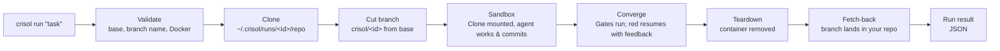

<p align="center">
  <picture>
    <source media="(prefers-color-scheme: dark)" srcset="assets/crisol-dark.svg">
    
  </picture>
</p>

<h1 align="center">Crisol</h1>

<p align="center">
  <strong>Run one Task in a container, unattended, and get back exactly one branch.</strong>
</p>

<p align="center">
  
  
  
  
  
</p>

---

A *crisol* (crucible) holds the fire while it works. Crisol does the same for a coding agent. It
clones your repo, runs the agent inside a Docker **Sandbox** that cannot touch your host, and
leaves **one named branch** in your repo when it is done. That happens whether the Run succeeded
or failed. Your working tree is never touched.

```console
$ crisol run "fix the login bug with + in emails" --json
{"run":"9f496a56","branch":"crisol/9f496a56","base":"main@a2689ba","status":"unverified", …}
```

> [!NOTE]
> **Crisol is a walking skeleton.** Every stage of a Run below works end to end today, including
> Gates, converge and least-privilege credentials. `crisol run` still defaults to a scripted
> stand-in Adapter; the real Claude Code Adapter exists (`--adapter claude-code`) but isn't the
> default yet, and the network wall is still open. See [Roadmap](#roadmap).

## Why

You can tell an agent to work on its own, but that is only safe if nothing it does can leak out.
Crisol keeps a Run apart from your host in three ways:

- **Its own Clone.** A Run never works in your checkout or a worktree. It gets a fresh clone that
  shares no `.git` and no objects with your repo
  ([ADR 0004](docs/adr/0004-clone-copies-objects-no-hardlinks.md)).
- **Its own Sandbox.** The agent runs in a container, and the only part of your machine it can see
  is that Clone.
- **One way back.** The only thing that returns to your repo is a branch, brought back by
  **Fetch-back**. Fetch-back runs `git fetch`; it never merges and never touches a working tree.

## How a Run works



1. **Validate first.** Crisol checks the base ref, the branch name and Docker before it touches
   anything, so an invalid Run leaves nothing behind.
2. **Clone and cut.** Crisol clones your repo with `git clone --no-local`. That copies only the
   objects reachable from your branches, tags and `HEAD`, so a dropped stash never gets into the
   Clone. Then it cuts `crisol/<id>` (or your `--name`) from the base.
3. **Sandbox.** The Clone is bind-mounted into a container at the same absolute path. The Adapter
   does the work and commits there.
4. **Converge.** Crisol — never the agent — decides done. It runs every declared Gate; any red one
   resumes the same session with the failing command and its output, up to a ceiling (5 iterations
   or 60 minutes). All green is `verified`; no Gate declared anywhere is `unverified`; hitting the
   ceiling is `not-converged`.
5. **Teardown and Fetch-back.** The container is removed, and the branch is fetched back into
   your repo. If the Run fails, Fetch-back still runs, so no work is lost. If it fails too, you
   see both errors. Ctrl+C, `kill` and closing the terminal stop a Run the same way: the
   container is removed and the branch still comes back with the commits made so far. Only
   `kill -9` skips this, and `crisol recover` brings that branch back.

## Requirements

| | |
|---|---|
| **OS** | macOS (Linux is planned) |
| **Runtime** | [Bun](https://bun.sh) |
| **Containers** | A running Docker engine: OrbStack, Docker Desktop, or Colima |
| **Repo** | Any git repo with at least one commit |

## Quick start

```sh
git clone https://github.com/matiinchauspe/crisol.git
cd crisol && bun install

# from inside any git repo you want to run against:
bun /path/to/crisol/src/cli.ts run "say hello" --json
```

To get a standalone `crisol` binary instead, run `bun run build`. It writes `dist/crisol`.

## Usage

```
crisol run "<task>"... [--json] [--base <ref>] [--name <branch>] [--gate <cmd>]... [--max-iterations <n>] [--timeout <minutes>] [--adapter <fake|claude-code>]
crisol auth
crisol recover
```

| Flag | Default | What it does |
|---|---|---|
| `--base <ref>` | your current `HEAD` | Branch, tag or sha to cut the Run's branch from. It must be reachable from a local branch, a tag or `HEAD`, because that is all the Clone receives. To use `origin/main`, check it out or fast-forward a local branch onto it first. |
| `--name <branch>` | `crisol/<id>` | The branch name the Run leaves in your repo. Refused before anything happens if it clashes with an existing branch, a tag, or a branch path (for example `feat` vs `feat/x`). Only with a single Task. |
| `--gate <cmd>` | none | A command whose exit code decides whether the work is right. Repeatable. Any `--gate` replaces your repo's own `.crisol/config.toml` Gates entirely — it never merges with them. |
| `--max-iterations <n>` | `5` | Overrides how many Gate-fail-then-resume attempts this Run gets before `not-converged`. Must be a positive integer. |
| `--timeout <minutes>` | `60` | Overrides the wall-clock ceiling for this Run, in minutes. Must be a positive integer. |
| `--adapter <fake\|claude-code>` | `fake` | Which Adapter runs the Task. `fake` is the suite's own scripted stand-in; `claude-code` runs the real Claude Code Adapter (`crisol auth` first — see [Credentials](#credentials)). |
| `--json` | off | Print the Run result as JSON instead of one line — one JSON line per Run when there are several Tasks. |

A repo can declare its own Gates once, in `.crisol/config.toml`:

```toml
gates = ["bun test", "bun run typecheck"]
```

### Several Tasks at once

```
crisol run "fix the login bug" "add a health check" "bump the README badges"
```

Each Task becomes its own independent Run: its own Clone, its own Sandbox, its own branch, all
cut from the same base commit. Crisol never chains or merges them — what to do with the branches
is up to you. With `--json`, each Run result is printed on its own line, in the order the Tasks
were given; a Run that fails prints its error on stderr, prefixed with its Task, and the command
exits non-zero without hiding the others.

At most `max_parallel` Runs execute at once (3 by default), across every `crisol run` on the
machine — including ones started from different terminals. A Run must hold one of
`~/.crisol/slots/<n>.lock` to execute; with none free it waits, printing
`Waiting for a free Slot`, and never fails for lack of one. The lock is an OS file lock, so a
Run that dies — even by `kill -9` — gives its Slot back at once. Ctrl+C on a waiting Run stops it
before it touches anything.

```toml
# ~/.crisol/config
max_parallel = 2
```

### Credentials

By default, no secret enters the Sandbox at all — the scripted stand-in Adapter declares none.
The real Claude Code Adapter (`--adapter claude-code`) declares exactly one,
`CLAUDE_CODE_OAUTH_TOKEN`, resolved from `crisol auth`'s Keychain entry below — run that first, or
the Run fails before anything happens, naming it. A repo that needs another secret declares it by
NAME, never by value, in the same `.crisol/config.toml`:

```toml
env = ["NPM_TOKEN"]
```

`NPM_TOKEN` is then read from your own shell's environment at launch — export it before running
`crisol run`. A name declared but missing from your environment fails the Run before anything
happens, naming it. Nothing from `$HOME` is ever mounted (no `~/.gitconfig`, `~/.ssh`,
`~/.config/gh`, `~/.aws`, `~/.claude`), and no push is possible from inside a Sandbox — the only
way a Run's work reaches your repo is Fetch-back.

```
crisol auth
```

Obtains a Claude Code OAuth token (wrapping `claude setup-token`) and stores it in Crisol's own
macOS Keychain entry, behind `SecretStore` — never on disk, never in your shell's history. The
Claude Code Adapter resolves `CLAUDE_CODE_OAUTH_TOKEN`'s value from there, the same way a
repo-declared secret resolves from your shell's environment. The Agent layer it runs in installs
the same Claude Code version as your host (`claude --version`) under a non-root `agent` user
(Claude Code itself refuses `--dangerously-skip-permissions` as root), and disables commit/PR
attribution by configuration inside the Sandbox — never by asking the model.

### Recover

```
crisol recover
```

Brings back the branch of every Run that died without its Fetch-back, for example after
`kill -9` or a crash. A Run holds its own lock while it is alive, so recover never touches a live
Run. For a dead Run, it first removes the Run's container, so the agent cannot keep writing to the
Clone. Then it fetches the branch into the repo the Run came from, at the Clone's last commit.
Fetch-back only fast-forwards: a branch you have since moved is reported and left alone, and
recover never deletes a branch. It prints one line per Run it acted on or left alone, or
`Nothing to recover.`

### The ceiling

A Run stops resuming once either of two ceilings hits first: 5 iterations, or 60 minutes of wall
clock. Both defaults are overridable, independently, in three layers — `--max-iterations`/
`--timeout` beat `~/.crisol/config`'s own `max_iterations`/`timeout_minutes` beat the built-in
default:

```toml
# ~/.crisol/config
max_iterations = 10
timeout_minutes = 90
```

An invalid value (anything other than a positive integer) in either the flag or the config file
fails the Run before anything happens, naming the flag — or the config file's path — and the key.

### The Run result

The fields are only ever added within 0.x, never renamed or removed:

```json
{
  "run": "9f496a56",
  "branch": "crisol/9f496a56",
  "base": "main@a2689ba",
  "status": "verified",
  "iterations": 2,
  "gates": [{ "cmd": "bun test", "ok": true }],
  "network": "open",
  "blocked": [],
  "warnings": [],
  "fetchBack": true
}
```

`status` is `verified` once every declared Gate is green, `not-converged` (with
`reason: "ceiling"`) if it never gets there within the ceiling (5 iterations or 60 minutes by
default — see [The ceiling](#the-ceiling)), and `unverified` when no Gate is declared anywhere —
the CLI's `--gate`, else the repo's own `.crisol/config.toml`.
A red Gate resumes the same agent session with its failing command and output; `iterations`
counts how many attempts that took. A Run stopped by a signal or an error is `not-converged` too,
with `reason` set to `interrupted: SIGINT` (or the signal it got) or `error: <message>`. The CLI
reports that as an error, and its Run result is in `result.json`. `fetchBack` says whether the
branch reached your repo; `false` means `crisol recover` can still bring it back. A container
Crisol could not remove is named in `warnings`. `network` reports `open` until the network wall lands
([ADR 0003](docs/adr/0003-run-result-reports-network-open-until-the-wall-exists.md)).

### Where things live

```
~/.crisol/                 # override with CRISOL_HOME
├── config                 # optional: max_parallel / max_iterations / timeout_minutes overrides
├── slots/<n>.lock         # one per Slot; a Run holds one while it executes
└── runs/<id>/
    ├── repo/              # the Run's Clone
    ├── lock               # held while the Run is alive; how `crisol recover` tells live from dead
    ├── log                # timestamped log of every stage
    └── result.json        # the Run result, written on every exit
```

## Roadmap

v1 is built as 18 tracer-bullet tickets. Each one leaves Crisol working end to end.

| # | Ticket | |
|---|---|---|
| 01 | Walking skeleton | ✅ |
| 02 | Gates and converge | ✅ |
| 03 | Slots and fan-out | ✅ |
| 04 | Fetch-back on every exit, and recover | ✅ |
| 05 | Detach, status, logs | |
| 06 | Network wall | |
| 07 | Editable Allowlist, learn and open | |
| 08 | Credentials | ✅ |
| 09 | Commits | |
| 10 | Text input | |
| 11 | Services | |
| 12 | Two-layer image and dependencies | |
| 13 | Provider failure and capacity | |
| 14 | Claude Code Adapter | ✅ |
| 15 | Tenaza inside | |
| 16 | `crisol gc` | |
| 17 | `crisol init` | |
| 18 | Release 0.1.0 | |

## Vocabulary and decisions

Crisol uses a small, strict vocabulary: **Run**, **Task**, **Sandbox**, **Clone**, **Fetch-back**,
**Gate**, **Adapter**, **Slot**, **Run lock**, **Fan-out**, **Secret**, **SecretStore**. Each term is defined in
[`docs/GLOSSARY.md`](docs/GLOSSARY.md). The decisions behind Crisol's shape are recorded in
[`docs/adr/`](docs/adr/):

- [0001](docs/adr/0001-adapter-takes-a-sandbox-handle.md): the Adapter takes a Sandbox handle, not a raw container id
- [0002](docs/adr/0002-ticket-01-sandbox-image-is-a-placeholder.md): ticket 01's Sandbox image is a placeholder
- [0003](docs/adr/0003-run-result-reports-network-open-until-the-wall-exists.md): the Run result reports `network: "open"` until the wall exists
- [0004](docs/adr/0004-clone-copies-objects-no-hardlinks.md): the Clone copies git objects and never shares them with the host
- [0005](docs/adr/0005-pre-start-declaration-replaces-post-start-wiring.md): a pre-start declaration replaces post-start wiring
- [0006](docs/adr/0006-ticket-02-gate-ladder-and-ceiling-are-placeholders.md): ticket 02's `.crisol/config.toml` parser is a hand-rolled placeholder; the ceiling override (CLI flags and `~/.crisol/config`) is implemented
- [0007](docs/adr/0007-ticket-08-credential-placeholders.md): `crisol auth` keeps the token off every spawned process's argv, verified against the real `security` CLI; its assumption about `claude setup-token`'s own output convention is not
- [0008](docs/adr/0008-claude-code-adapter-agent-layer-and-attribution.md): the Claude Code Adapter's Agent layer runs as a non-root `agent` user (Claude Code refuses `--dangerously-skip-permissions` as root) and installs via the native installer (not npm); attribution is disabled by a baked `settings.json` rather than a CLI flag or the Preamble; `PreStartDeclaration` gains `ensureImage` rather than the plain `image: string` ADR 0005 sketched
- [0009](docs/adr/0009-slots-poll-a-non-blocking-flock.md): a Slot is taken by polling a non-blocking `flock` rather than blocking on it, before the Run reserves anything; a fan-out prints one Run result per line
- [0010](docs/adr/0010-a-run-lock-proves-liveness-and-signals-never-reach-crisols-children.md): each Run holds its own lock, which is how `crisol recover` tells live from dead; SIGINT, SIGTERM and SIGHUP stop a Run the same way from the moment it is reserved; git and docker children run in their own session; `result.json` is written on every exit and records `fetchBack`

## Development

```sh
bun test     # the suite; needs a running Docker engine
bun check    # typecheck
```

The tests drive real `git` and real Docker against throwaway repos and a throwaway `CRISOL_HOME`.
`crisol run` always defaults to the scripted stand-in Adapter unless `--adapter claude-code` is
passed explicitly, so the suite never calls a model or builds the real Agent layer image.

## License

[MIT](LICENSE)
